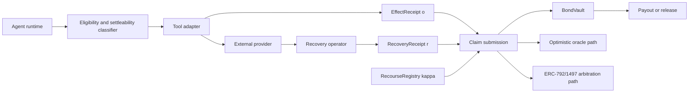

# Architecture

Recourse is a two-tier prototype. The runtime tier creates evidence and routes tool calls. The on-chain tier holds recourse contracts, collateral, claim state, and settlement outcomes. The current repository implements the local contract core, runtime SDK, pure classifier predicates, and deterministic synthetic evaluation harness.

## Design Source

Authoritative references:

- Implemented behavior: production source plus its tests.
- Schema pins: `prototype/SCHEMA_VERSIONS.md`.
- Audited visual source: `docs/recourse-architecture.html`.
- Paper-claim provenance: `prototype/reproducibility/paper-claims.v1.json`.

The historical implementation plan records design intent; it does not override tested source.

## System Flow

All boxes have local implementations or deterministic mocks. The Postgres and cloud integrations run in Docker; Git uses a local bare repository. These environments validate provider-compatible behavior but do not establish managed-provider signatures or public replay.

## Current Components

| Component | Implemented files | Paper mapping | Status |
| --- | --- | --- | --- |
| Canonical schemas | `prototype/schemas/*.v1.json`, `prototype/schemas/examples/*.json`, `prototype/SCHEMA_VERSIONS.md` | `main.tex:115` for `kappa`, `main.tex:232` for effect receipts, `main.tex:251` for recovery receipts, `main.tex:318` for schema versioning | Implemented v1. |
| Cross-language projections | `prototype/runtime-ts/packages/receipts/src/types.gen.ts`, `prototype/contracts/src/Types.sol`, `prototype/schemas/verify_parity.py` | `main.tex:232` and `main.tex:251` | Implemented as checked-in projections and a name-level parity verifier. |
| EIP-712 hashing and signatures | `prototype/runtime-ts/packages/receipts/src/*.ts`, `prototype/contracts/src/Eip712Recourse.sol`, `prototype/schemas/eip712_fixture.json` | `main.tex:310` evidence and typed receipts | Implemented for effect, recovery, and claim signing/verification in TS; Solidity parity tests cover effect, recovery, and claim digests. |
| On-chain local core | `prototype/contracts/src/{RecourseRegistry,BondVault,ClaimRegistry,OptimisticPath,ArbitrablePath}.sol` | `main.tex:121`, `:159`, `:268`, `:310` | Implemented locally with mocks and Foundry tests. |
| Runtime packages | `prototype/runtime-ts/packages/*` | `main.tex:159`, `:232`, `:251`, `:310` | Implemented source-first Bun packages for evidence, adapter lifecycle, workload adapters, compensator lifecycle, and workload compensators. |
| Classifier project | `prototype/classifier/src/recourse_classifier/*.py`, `prototype/classifier/tests/*` | `main.tex:142` settleability predicate | Implemented as pure eligibility, settleability, and routing predicates. |
| Harness project | `prototype/harness/src/recourse_harness/*.py`, `prototype/harness/tests/*` | `main.tex:348` evaluation protocol | Implemented deterministic traces, observed fault overrides, metrics, baselines, repetition summaries, and RQ drivers. |
| RQ runner | `prototype/scripts/run-rq.sh` | `main.tex:348` evaluation protocol | Runs configured deterministic synthetic RQ cells into `prototype/results/<rq>/`. |
| Local provider integrations | `prototype/integration/`, `prototype/scripts/provider-*`, `prototype/runtime-ts/packages/adapter-*` | Provider-compatible evaluation | Implemented against Docker Postgres, local bare Git, and LocalStack; L2 adapter evidence only. |
| Reproducibility control | `prototype/reproducibility/`, `prototype/scripts/reproduce.sh`, `prototype/scripts/validate-reproduced-results.py` | All generated paper assets | Checksummed frozen evidence, independent-seed CIs, and claim-to-asset validation. |
| Deployment output | `prototype/contracts/script/DeployBaseSepolia.s.sol`, `prototype/scripts/deploy-base-sepolia.sh`, `prototype/scripts/export-abi.sh`, `prototype/deployments/base-sepolia/` | Live public-testnet deployment | Current ABI snapshots plus a Base Sepolia record whose bytecode is independently verified to match current source. |

## Invariants

- Schema version `1` is pinned across JSON schemas, TypeScript types, Solidity structs, and EIP-712 domain version.
- EIP-712 receipt changes must update both TypeScript typed data and Solidity typehashes, then re-pin `prototype/schemas/eip712_fixture.json`.
- The classifier consumes `(kappa, verified observations, runtime context)`. Scope, provenance, and collateral must never be inferred from self-asserted κ fields.
- Harness fault labels must remain separate from observed fault inputs: `faultRoute` is an expected-route metric label, while the Recourse baseline recomputes the route through `recourse_classifier.routing.route_claim`.
- Provider-sandbox artifacts must remain explicitly marked `provider_backed=false` and `provider_compatible_sandbox=true`.
- The contract tier enforces commitment identity, deadlines, route, cap, exposure, and payout state. It does not authenticate raw EIP-712 receipts or recompute payout schedules.

## Production Gaps

- Managed-provider attestations or authenticated L0 replay.
- Atomic action admission coupled to collateral reservation.
- On-chain receipt verification and payout recomputation.
- Raw-evidence/CID discovery from the on-chain commitment.
- A production ERC-792 backend and a fresh deployment of the audited source.
